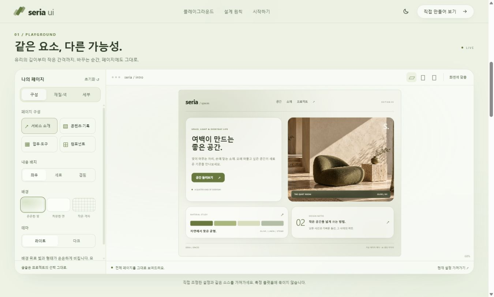
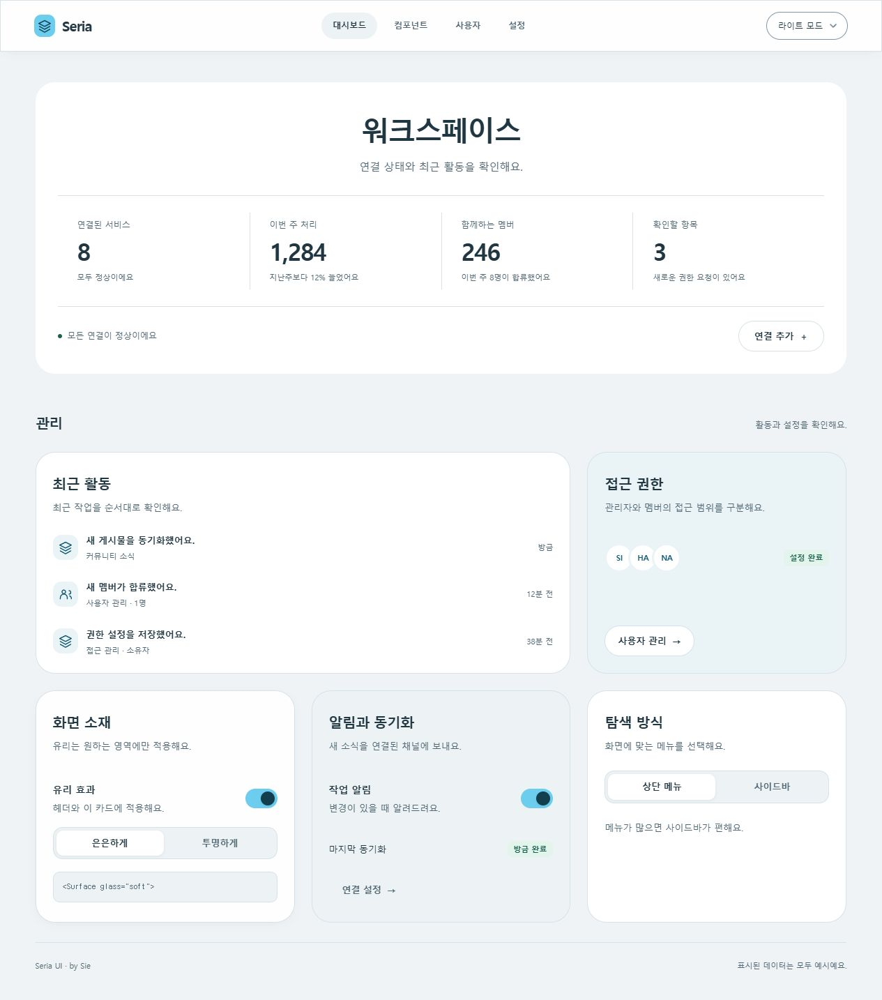
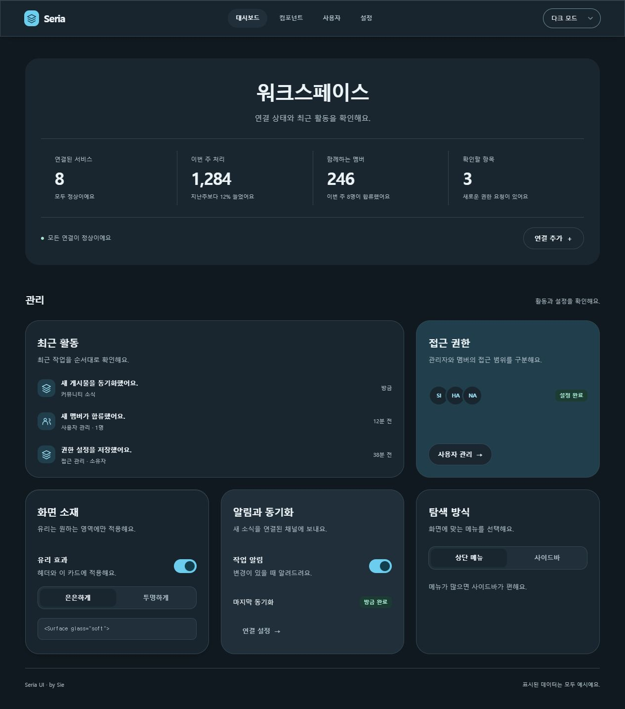

# Seria UI

필요한 요소를 조합해 나만의 페이지를 만드는 React 웹 UI 시스템이에요.
화면마다 따로 정하던 색상, 간격, 컴포넌트와 움직임을 한곳에 모았어요.

라이트·다크·시스템 테마, 상단 메뉴·사이드바 레이아웃을 제공해요.
라이트 배경은 회색에 하늘빛을 조금 더하고 흰 카드로 구분했어요.
기본 카드는 불투명하고, 유리 효과는 필요한 곳에만 켤 수 있어요.
Tailwind나 별도 UI 키트 스타일 없이 사용할 수 있어요.
Seria는 글꼴을 선택하거나 로드하지 않아요. 사용하는 프로젝트의 글꼴을 상속하며, 폰트 설정은 프로젝트에서 관리해요. [글꼴 적용 범위](./docs/tokens.md#글꼴)

## 인터랙티브 쇼케이스

[Seria UI Studio](https://seria-ui-studio.honey-puppy-6755.chatgpt.site)의 첫 화면은 배치·표면·색상·반응형 변화를 자동으로 보여주는 짧은 소개예요. 진입하면 한 번 재생하고, 마지막 장면에서는 가득 찬 진행 바와 다시 보기 버튼을 유지해요. 다시 보기를 누르면 처음부터 재생해요. 버튼으로 멈추거나 장면을 직접 고를 수도 있어요. 화면 밖이나 비활성 탭에서는 멈춰요. 모션 감소 설정에서는 공간 이동을 생략하고 설명에 짧은 페이드만 적용하며 순차 전환과 재생/정지는 유지해요.
아래 플레이그라운드에서는 네 가지 조합 예시를 직접 바꿔보고 시작 코드를 가져갈 수 있어요. 사이트는 소유자 비공개로 배포해요.

1.8의 소개와 플레이그라운드는 같은 올리브 배경과 유리 표면으로 이어집니다. 예시에는 유리를 기본 적용하며 농도·흐림·채도, 강조색, 모서리·간격·글자 크기, 경계·그림자·움직임과 화면 너비를 직접 조절할 수 있어요. 서비스 소개·콘텐츠·업무·컴포넌트 예시와 좌우·세로·겹침 배치, 배경·라이트/다크도 같은 설정을 사용해요. 라이브러리 기본 표면은 기존처럼 불투명하며 유리는 선택 사항입니다.

1.8.2부터 기본 미리보기는 ‘자동 너비 + 읽기’예요. 화면 너비에 맞춰 실제 내용을 다시 배치하며 작은 화면에서도 본문 크기를 유지해요. 안에서 스크롤하면 아래 내용을 읽을 수 있어요. ‘전체 보기’는 전체 구성을 축소해 보여주고, ‘100%’와 수동 너비는 지정한 크기를 검사할 때 사용해요. 설정 패널은 별도로 스크롤하고 모바일에서는 설정과 미리보기를 전환해요. 현재 설정의 `main.tsx`와 예제 원본을 복사하거나 파일로 받을 수 있어요.

주요 소개 섹션은 최소 한 화면 높이를 사용하고 섹션 경계에서 입력 방향에 맞춰 이동해요. 긴 모바일 섹션 안에서는 자유롭게 읽을 수 있어요. 확대해서 내용이 더 길어지면 섹션도 자연스럽게 길어져요. 구분선 대신 같은 올리브 계열의 배경 농도와 빛의 위치가 달라집니다.



소개 사이트는 올리브를 기본으로 연두·포레스트·세이지를 함께 사용해요. 예시 페이지는 계속 보이면서 배치와 색상이 바뀌고, 설명만 진행 방향에 맞춰 이동하며 나타나고 사라져요. 모션 감소 설정에서는 공간 이동을 생략하고 설명에만 짧은 페이드를 사용해요. 이 색상 선택은 쇼케이스에 적용되며 Seria를 가져오는 프로젝트는 자신의 테마를 사용해요.

메인과 서비스 소개 예시는 `Seria / Spaces`라는 가상의 공간 편집 페이지예요. 전용 AI 생성 이미지와 실제 Hero·Card·Columns를 조합해요. 1.5.1부터 모션 감소 환경에서도 사용자가 직접 누르는 재생은 허용해요.

재생 컨트롤은 진행 막대·장면 점·재생/정지를 하나의 작은 캡슐에 담았어요. 호버나 키보드 포커스 시 간격과 제목 라벨이 나타나요. 터치는 한 번으로 제목을 확인하고 같은 점을 다시 누르면 장면으로 이동해요. 방향키로도 장면을 바꿀 수 있어요.

로컬에서는 `npm run dev:showcase`로 실행하고 http://127.0.0.1:5207 에서 열어요. `npm run build:showcase`는 `showcase-dist/`를 만들어요.

## 같은 구성으로 바로 시작하기

1.9부터 **소개 사이트 전체 시작 프로젝트**를 제공해요. 자동 소개·플레이그라운드·상단 메뉴·모든 섹션·마무리를 현재 사이트의 같은 원본으로 실행하고 수정할 수 있어요. `seria-ui-studio-1.9.1.tar.gz`를 받고 `npm install`, `npm run dev`로 시작하세요.

소개에서 쓰는 `Presentation`, `BrowserFrame`, `CodeExample`, `PreviewCanvas`, `usePlayback`, `useSceneTransition`, `useLayoutTransition`, `useSectionScroll`도 공개 API로 가져올 수 있어요. [모든 UI·도구·레이아웃과 사용 방법](./docs/studio.md)

1.6부터 쇼케이스 구성과 전용 스타일을 `examples/`에 함께 제공하며 1.8에서 컴포넌트 실험 페이지를 더했어요. 미리보기와 복사 코드는 같은 원본을 사용합니다.
전체 시작 파일에는 React 실행 환경, 이미지와 동일 버전의 라이브러리가 들어 있어요. 압축을 풀고 `npm install`, `npm run dev`로 실행하세요.
[시작 파일 받기](https://seria-ui-studio.honey-puppy-6755.chatgpt.site/#start) · [기존 페이지 적용·업데이트 안내](./docs/adoption.md)

소개 예시의 편집 디자인은 선택적인 예제입니다. 기본 컴포넌트가 특정 브랜드나 서체를 강제하지 않아요.

## 기존 패널 예제

| 라이트                                  | 다크                                 |
| --------------------------------------- | ------------------------------------ |
|  |  |

[모바일](./screenshots/mobile.png) · [컴포넌트](./screenshots/components.png) · [사용자](./screenshots/members.png) · [설정](./screenshots/settings.png)

예제의 사용자와 처리 내역은 모두 샘플 데이터예요. 실제 인증이나 서비스 연동은 포함하지 않아요.

## 실행

Node.js 22.12 이상이 필요해요.

```sh
git clone https://github.com/tsukino-sie/seria-ui.git
cd seria-ui
npm ci
npm run dev
```

미리보기는 http://127.0.0.1:5206 에서 열려요.

## 내 프로젝트에 사용

이 저장소에서 빌드한 뒤 패키지 파일을 만들어요.

```sh
npm run build
npm pack
```

사용할 React 프로젝트에서 생성된 `seria-ui-1.9.1.tgz`를 설치해요.
React 18.3 이상 또는 19, Headless UI 2.2 이상과 함께 사용해요.

```sh
npm install /path/to/seria-ui-1.9.1.tgz
```

```tsx
import { ThemeProvider, ThemePicker, Card, Button } from 'seria-ui';
import 'seria-ui/styles.css';

export function App() {
  return (
    <ThemeProvider>
      <Card>
        <h1>내 패널</h1>
        <ThemePicker />
        <Button onClick={() => console.log('저장')}>저장</Button>
      </Card>
    </ThemeProvider>
  );
}
```

유리는 `glass="soft"` 또는 `glass="clear"`로 선택해요.
일반 HTML에도 `data-glass="soft"`를 붙일 수 있어요.

## 색상 바꾸기

`<ThemeProvider accent="#794de8">`처럼 강조색을 전달해요.
사용자·플랫폼별 설정과 라이트·다크 토큰을 따로 연결할 수 있어요. [설정 방법](./docs/tokens.md) · [강조색 예시](./screenshots/theme-purple.png)

## 구성

1.5부터 `PlaybackControls`로 진행 바·구간 이동·재생/정지를 하나의 캡슐에 구성해요.
진행 색은 라이트·다크와 `ThemeProvider accent`를 따르며 개별 색상 토큰으로 바꿀 수 있어요.
React 컴포넌트와 `PlaybackItem`, `PlaybackControlsProps`, `PlaybackControlsLabels`, `PlaybackControlsStyle` 타입을 함께 제공해요. [사용 방법](./docs/components.md#재생과-구간-이동-15)

- **Design Tokens** — 색상, 간격, 곡률, 그림자, 글꼴 크기를 CSS 변수로 관리해요. [토큰](./docs/tokens.md)
- **Component Primitives** — Button, Input, Card, Dialog, Dropdown 등 기본 요소와 레이아웃을 제공해요. [컴포넌트](./docs/components.md)
- **Motion Guidelines** — hover, focus, 전환과 등장 효과의 시간·이동량을 통일해요. 모션 감소 설정도 따라가요. [움직임](./docs/motion.md)

`src/`가 소스이고 `demo/`가 예제예요. 빌드한 모듈은 `dist/`, 정적 예제는 `preview/`에 생성돼요.

```sh
npm run check       # 타입과 기본 색상 대비
npm run build       # 모듈
npm run build:demo  # 정적 예제
npm run format     # 코드 정리
```

## 설계와 유지보수

특정 기업이나 플랫폼의 외형보다 읽기 쉬운 정보, 예측 가능한 조작, 재사용 가능한 구조를 기준으로 판단해요.
[설계 기준](./DESIGN-REFERENCES.md)에 적용 범위와 변경 시 확인할 항목을 정리했어요.
현재 컴포넌트는 React 웹용이며 CSS 토큰은 다른 웹 환경에서도 사용할 수 있어요.

## 이용 조건

원작자는 **Sie**예요. **Sie 원작자 표기를 유지하면 비상업적·상업적 사용, 수정, 재배포가 가능해요.**
원작자 표기는 프로젝트 문서와 소개·크레딧·라이선스 화면처럼 확인할 수 있는 곳에 남겨 주세요.
자세한 조건은 [LICENSE](./LICENSE), 표기 방법은 [NOTICE](./NOTICE)를 확인해 주세요.
외부 라이브러리는 [각 라이선스](./THIRD-PARTY-NOTICES.md)를 따라요.
출처 정보는 패키지와 화면 구조에도 포함해요. [출처 표기](./docs/provenance.md)
